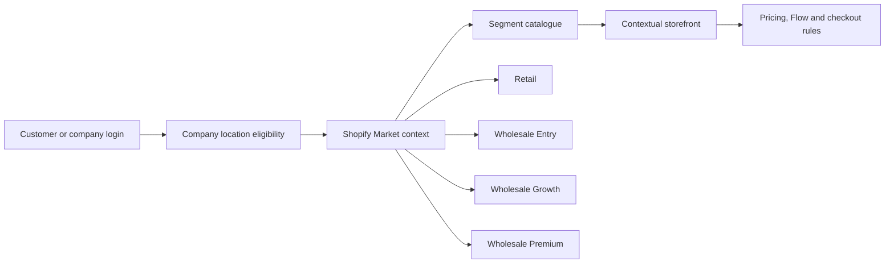
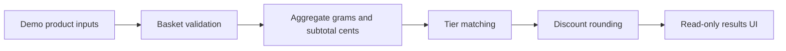

# Multi-segment Shopify B2B architecture demo

**Interactive route:** `/b2b-demo` on a deployed version of this Next.js portfolio.

This demonstration shows how one Shopify ecosystem can serve **Retail, Wholesale Entry, Wholesale Growth, and Wholesale Premium** customer contexts with different catalogue access, storefront treatment, and business rules. The included weight-based calculator remains an independently developed example of one rule inside that wider architecture.

The page is **public-safe portfolio code**, not a copy of an employer's Shopify configuration, theme, catalogue, customer records, or pricing contracts.

## Architecture



## Segment model

| Segment | Commerce role | Public demo purpose |
| --- | --- | --- |
| Retail | Direct-to-consumer market | Shows the consumer context and the separation from wholesale-only catalogue access. |
| Wholesale Entry | Lower-volume B2B market | Illustrates a starting trade catalogue and business-specific storefront context. |
| Wholesale Growth | Growing B2B market | Illustrates expanded catalogue access and segment-specific merchandising. |
| Wholesale Premium | High-volume B2B market | Illustrates premium account treatment and higher-volume commercial workflows. |

The segment names describe the business architecture. The public site does not expose live company assignments, catalogue membership, private price lists, payment terms, product IDs, or customer data.

## Why the Online Store channel and Retail catalogue are different controls

A B2B product can need the **Online Store sales channel** so authenticated wholesale buyers can discover and render it through the storefront. Retail availability is still governed by the **Retail market catalogue**. Keeping those controls separate allows wholesale-only products to remain available to eligible B2B contexts without becoming available in the retail market.

## Interactive pricing rule

The lower section of the page keeps the original fictional basket simulator:

1. Validate product quantities.
2. Aggregate product weight in grams.
3. Calculate the fictional subtotal.
4. Match the basket to a fictional weight tier.
5. Apply the example discount.
6. Display subtotal, saving, total, and next-tier distance.



## Run locally

```sh
npm install
npm test
npm run dev
```

Visit `http://localhost:3000/b2b-demo`.

## Validation

`node --test tests/*.test.mjs` checks zero basket, combined product weights, boundary thresholds, highest tier, invalid input, and immutability. GitHub Actions also checks TypeScript and the Next.js production build. CI results should be checked in GitHub rather than assumed successful until completed.

## Production boundaries

The interactive calculator is frontend-only and fictional. Actual B2B eligibility, catalogue assignment, price entitlement, inventory, tax, shipping, payment, checkout discounts, and company-location access require platform-authorised controls.

No genuine products, credentials, customer records, company assignments, private pricing, production thresholds, store identifiers, webhook payloads, APIs, or employer-owned source are present.
