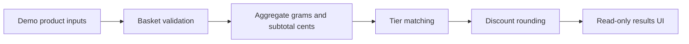

# Weight-based B2B pricing simulator

**Interactive route:** `/b2b-demo` on a deployed version of this Next.js portfolio.

This demonstration shows aggregate order weight, current fictional wholesale tier, next threshold, subtotal, savings and total. It is **independently developed example code**, not the source of a client's Shopify catalogue, automation or theme.

## Architecture


## Run locally
```sh
npm install
npm test
npm run dev
```
Visit `http://localhost:3000/b2b-demo`.

## Validation
`node --test tests/*.test.mjs` checks zero basket, combined product weights, boundary thresholds, highest tier, invalid input, and immutability. GitHub Actions also checks TypeScript and the Next.js production build. CI results should be checked in GitHub, not assumed successful until completed.

## Production boundaries
This is a frontend-only calculator. Actual wholesale eligibility, price entitlement, inventory, tax, shipping, payment and checkout discounts require platform-authorised server-side controls. No genuine products, credentials, thresholds, customer data, webhook payloads, APIs or business rules are present.
