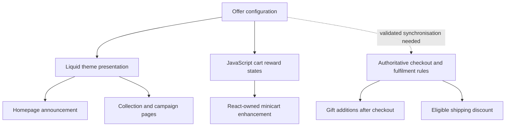

# Configuration-led rewards: one source for many customer touchpoints

An independently authored **public portfolio demonstration**, inspired by general Shopify engineering practice. The implementation is **not an export of any employer's store**, promotion, workflow, theme or cart integration. All thresholds and rewards are fictional.

## Problem and goal

When promotional content is separately maintained in announcement bars, product collections, campaign landing pages, an app-owned minicart, checkout messaging, Shopify Flow and delivery discounts, values and claims can drift. That makes a campaign costly to maintain and can confuse shoppers. The design goal is one editorial configuration for every customer-facing message, while retaining authoritative enforcement in checkout, gift fulfilment and shipping logic.

## Data model (illustrative)

A single Shopify metaobject might expose:
- `enabled` — boolean
- `gift_threshold`, `shipping_threshold`, `bonus_threshold` — positive numbers, strictly ascending
- `gift_label`, `bonus_label`, `short_line`, `terms` — edited content
- `offer_link` — optional URL

The real demonstration does **not** query Shopify: [`lib/rewards-engine.mjs`](lib/rewards-engine.mjs) provides a fictional static object that the interactive page can edit locally.

## Why distinct layers matter

**Liquid:** Reads storefront-visible structured data and renders theme-native content with explicit empty/disabled states. Do not scatter threshold literals across multiple section schemas.

**JavaScript:** Reads the current subtotal, derives unlocked milestones and next-reward messaging from configuration, and interpolates across uneven threshold distances without changing qualification logic.

**Third-party React cart:** Treat the cart as app-owned. For an *open* ShadowRoot, discover the existing drawer, attach scoped style/data hooks, observe relevant rerenders, and insert the progress enhancement idempotently. Keep quantity, subscription, totals and checkout operations with the app. Never attempt to cross a closed ShadowRoot.

**Shopify Flow:** Gift fulfilment is a different responsibility from storefront messaging. A post-checkout workflow should independently re-evaluate eligible orders, exclude gifts from spend as required, apply zero-priced gifts through authorised platform actions, and guard against duplicate execution. The exact trigger and actions depend on the real shop setup; they are **not implemented in the demo**.

**Delivery discounts and checkout:** The marketing milestone alone does not grant delivery eligibility. Shipping qualification must be implemented and enforced by the Shopify discount/rate rules for the applicable region, basket and subscription context. Checkout extensions are a distinct supported surface and cannot be assumed to share theme Liquid.

## Demo and test coverage

- [Interactive simulator](/rewards-engine) — independently authored Next.js presentation with editable synthetic offer, homepage, collection and minicart previews.
- [Reward engine](lib/rewards-engine.mjs) — pure JavaScript with offer validation, next milestone, remaining spend and visual progress.
- [Boundary tests](tests/rewards-engine.test.mjs) — exact thresholds, invalid/disabled configuration, changed values and negative spend.
- [Third-party cart development history](THIRD_PARTY_CART_HISTORY.md) — public-safe engineering lessons about Shadow DOM, hydration, scoped hooks, fallback and QA.

## From mock-up to maintainable operation

1. Map all consumer touchpoints and identify their owning technologies.
2. Model the reward offer as typed, editor-friendly structured content.
3. Prototype dynamic homepage, collection, campaign and cart copy.
4. Preserve app-owned React and checkout behaviour.
5. Keep editorial messaging and fulfilment decisions separate, with explicit synchronisation checks.
6. Test at the threshold boundaries; QA mobile, cart reopening, subscription changes, exclusions and failure fallback.
7. Use analytics to assess AOV, threshold attainment, qualifying orders, gift cost, net contribution and checkout completion. Do not claim uplift without an agreed baseline and attributable evidence.

## Publication boundaries

No real gift product identifiers, store or theme IDs, private Flow exports, client code, private customer/order data, credentials or unapproved commercial results are included. This demo does not change a live Shopify theme, order, delivery rate, or third-party cart.
