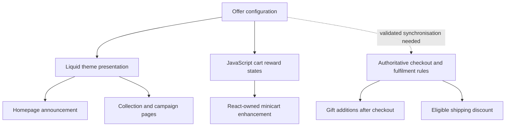

# Configuration-led rewards: one source for many customer touchpoints

An independently authored **public portfolio demonstration**, inspired by general Shopify engineering practice. The implementation is **not an export of any employer's store**, promotion, workflow, theme or cart integration. All thresholds and rewards are fictional.

## One developer. One connected commerce experience.

**Role:** End-to-end e-commerce engineer — analytics, conversion strategy, UI/UX design, Shopify development, integration engineering, testing and documentation.

**The challenge:** A promotion is not one banner. It follows a customer from the homepage to a product card, collection page, seasonal landing page, cart and checkout. When each surface holds its own amounts, gift labels and terms, every campaign change becomes a checklist: update the header, update templates, update the cart, verify shipping, verify fulfilment, then hope no message was missed. Third-party cart technology adds another layer of complexity. Inconsistent messages weaken trust precisely when the shopper is deciding whether to add more.

**My approach:** I worked backwards from a commercial question — *how can we make the next meaningful reward visible at the moment of purchase, while making future campaigns easier to maintain?* — and designed a configuration-led rewards architecture. One structured offer provides the editorial truth; each storefront surface translates that data into the right experience for its context. Instead of hardcoding an amount or a product name into every banner, a merchandising edit can update all connected presentation surfaces.

**What I bring to the table:** I do not stop at spotting a conversion leak or designing a mock-up. I can trace the underlying technology, model the data, write the Liquid and JavaScript, integrate with a third-party React-rendered cart without replacing its transactional logic, coordinate Shopify Flow fulfilment rules, review analytics, test edge cases and leave maintainable documentation behind. This joins commercial judgement with implementation detail.

### Problem → solution → engineering capability

| Disconnected problem | Engineering solution | Capability shown |
| --- | --- | --- |
| Reward thresholds and wording repeated across pages | Define typed, editor-managed metaobject values; render shared content through Liquid | Shopify custom data, schema design, Liquid |
| Header, product-card promo placements, collections and campaign pages risk disagreeing | Reuse one offer reader and context-appropriate display blocks; confirm each placement is actually wired before claiming coverage | Online Store 2.0 sections, templates, HTML/CSS, responsive UI |
| Shoppers cannot see what a slightly larger basket would unlock | Calculate exact spend remaining and display a progressive reward rail | JavaScript state modelling, UX, conversion strategy |
| The visible cart is owned by a third-party React application | Enhance its open Shadow DOM with narrowly scoped styles, stable hooks, mutation handling and graceful fallback | Browser debugging, Shadow DOM, JavaScript, integration resilience |
| Cart reward messaging is mistaken for gift delivery | Keep shopper-facing qualification separate from authoritative order-level gift fulfilment | Shopify Flow, order lifecycle, idempotency safeguards |
| Shipping and reward wording may disagree with checkout | Validate discount, postcode and subscription rules independently; check consistency on every offer change | Cross-system troubleshooting, Shopify shipping and checkout reasoning |
| Campaign decisions are made without evidence | Review channel-level AOV, basket thresholds, conversion and reward costs; separate trends from causation | ShopifyQL, analytics interpretation, commercial analysis |
| Small changes are difficult to maintain safely | Use isolated development, documented change history, boundary tests and release checks | Git/GitHub, QA, regression testing, Vercel/CI practices |

### How the system is managed

1. **Define** a structured offer: enabled state, milestone values, reward copy, short messaging and terms. Typed fields reduce the chance of invalid updates.
2. **Change** the relevant amount or reward description once in the agreed editorial configuration.
3. **Read** the same values through reusable Liquid readers for supported theme surfaces and safe configuration passed to the cart enhancement.
4. **Render** each touchpoint appropriately: compact homepage/header messaging, product-card or collection callouts where integrated, seasonal landing content and an interactive cart-progress rail.
5. **Enforce and verify** gift and shipping eligibility using their separately owned Shopify Flow/discount rules. These rules are **not automatically rewritten by an editorial metaobject change** in this documented approach.
6. **Measure** the behaviour with Shopify Analytics. Track Online Store AOV, threshold attainment, order mix, conversion and gift contribution, and evaluate a post-release period before claiming uplift.

**Important implementation boundary:** The observed storefront implementation connects several theme messaging surfaces and a third-party minicart to centrally managed offer values. Additional product-card placements and checkout UI would require their own integration and verification. The minicart is the *pre-checkout* experience; it is not the Shopify checkout. A future fully synchronised system should add verified automated reconciliation for backend Flow and shipping rules, rather than claiming changing a metaobject alone currently changes fulfilment.

### End-to-end delivery, not isolated tasks

I approached the work as a complete problem-solving cycle: investigate customer and operational friction → assess the data → design the mock-up → identify technology ownership → structure the configuration → implement responsive Liquid/JavaScript interfaces → integrate safely with the app-rendered cart → validate fulfilment boundaries → document and test → measure outcomes.

The maintainability benefit is immediate: connected **storefront copy and milestone displays** no longer require independently hardcoding every value. The business effect is the hypothesis to evaluate: clearer next-reward messaging may motivate a larger basket. Historical AOV trends on the real project were favourable before this particular cart-progress release; they are **not proof that the new ladder caused growth**.

**Portfolio positioning:** *I combine the analytical mindset of a conversion specialist, the visual judgement of a UI/UX designer and the implementation depth of a Shopify engineer. I can own the journey from problem discovery to a tested, maintainable solution — and I know how to distinguish an impressive interface from a commercially proven result.*

## Problem and goal

When promotional content is separately maintained in announcement bars, product collections, campaign landing pages, an app-owned minicart, checkout messaging, Shopify Flow and delivery discounts, values and claims can drift. That makes a campaign costly to maintain and can confuse shoppers. The design goal is one editorial configuration for every customer-facing message, while retaining authoritative enforcement in checkout, gift fulfilment and shipping logic.

## Data model (illustrative)

A single Shopify metaobject might expose:
- `enabled` — boolean
- `gift_threshold`, `shipping_threshold`, `bonus_threshold` — positive numbers, strictly ascending
- `gift_label`, `bonus_label`, `short_line`, `terms` — edited content
- `offer_link` — optional URL

The real demonstration does **not** query Shopify: [`lib/rewards-engine.mjs`](lib/rewards-engine.mjs) provides a fictional static object that the interactive page can edit locally.

## Engineering walkthrough: from configuration to customer experience

This project illustrates how one engineer combines design, data modelling, frontend implementation, third-party integration and post-purchase operations. The following is a **generalised technical pattern**, not a verbatim export of the employer's source.

### A. Create the editorial source: Shopify metaobjects

The promotion uses an editor-managed object to hold whether the offer is enabled, ordered spend milestones, reward descriptions, the short announcement line and terms. Product-specific metafield references can be added for contextual placements where needed, but the offer's threshold definitions should not be duplicated in dozens of theme sections.

**Production pattern:** Liquid validates that an offer exists and that its thresholds are ordered; missing or disabled configuration hides the custom reward display. The Liquid bridge serialises safe, typed values into an inert JSON script for the cart runtime. Thresholds are converted to cents rather than comparing formatted strings.

**Benefit:** A merchandiser can change the displayed reward names or amounts in one structured editor instead of changing a homepage banner, collection section and cart script individually. Backend promotion rules are a separate approval/check step.

### B. Use the right presentation layer at each touchpoint

| Customer journey stage | Presentation responsibility | Technology |
| --- | --- | --- |
| Homepage/announcement bar | Concise offer message | Shopify Liquid, reusable snippet, HTML/CSS |
| Product discovery / card | Contextual offer placement *where connected* | Shopify theme sections, card templates and references |
| Collection and seasonal page | Rich offer strip alongside relevant merchandising | Custom templates, sections, Liquid, CSS |
| Third-party minicart | Current reward, exact spend remaining, three-stage progress rail | JavaScript, cart AJAX response, scoped styling, open Shadow DOM |
| Checkout | Authoritative shipping and payment rules; not the minicart | Shopify-supported checkout/discount configuration |
| After checkout | Add qualifying free gift items to an order | Shopify Flow and order processing |

These are **distinct owners**, not one React application. In particular, the third-party minicart was rendered by React, but the custom progress component is a **plain JavaScript enhancement**, not a replacement React component.

### C. Solve the React/Shadow DOM integration boundary

The visible cart was not owned by the theme's native drawer. Editing that drawer would not have updated the customer's actual experience. The enhancement had to find the app-owned drawer, traverse **open** shadow roots and insert its own stylesheet into the same root.

The generalised runtime follows this sequence:

1. Read validated offer configuration produced by Liquid.
2. Discover the app-rendered drawer; retry during app hydration, without crossing closed roots.
3. Read the cart subtotal via Shopify's cart AJAX response.
4. Compare the subtotal against real monetary thresholds, compute the next reward and remaining amount in cents, then position the visual rail.
5. Inject a single accessible progression block and update its copy after quantity changes, rerenders, drawer reopen and relevant cart interactions.
6. Apply stable scoped hooks for typography/spacing instead of relying on changing utility class combinations.
7. Retain the app's own cart functionality and show its original promotional UI if configuration, discovery or rendering fails.

**Design nuance:** The rail's three milestones can be spaced equally *visually* even where the monetary gaps are unequal. Reward qualification must use exact configured thresholds, never the percentage filled on the rail.

**Engineering nuance:** A `MutationObserver` and idempotent render path handle React rehydration without duplicate components or aggressive DOM replacement. A custom enhancement must never seize control of checkout, subscriptions, cart totals or quantity logic from the vendor.

### D. Complete the promise through Shopify Flow

After purchase, an independently managed Shopify Flow workflow evaluates eligible orders and adds the qualifying gift lines for fulfilment. The storefront progression does **not** add gifts to the customer's cart or charge for them. Shipping qualification belongs to separate delivery/discount rules.

The documented production pattern includes order event handling, reward threshold branches and line-item additions. A production safety review must verify the **current** Flow product mappings, qualifying subtotal basis, subscription renewals, idempotency and duplicate prevention. These details are not reproduced in the portfolio and should not be assumed to be automatically synchronised with the editorial metaobject.

### E. Turn the implementation into an engineering practice

The workflow is more than a mock-up: analyse funnel friction, design the progression, identify which system owns each page element, build reusable components, QA exact reward boundaries, preserve fallback paths, version-control documentation and measure the commercial response.

Tests should cover empty and gift-card-only baskets, just-below/at/above every threshold, discounted totals, quantity changes, app rerenders, disabled configuration, mobile widths, subscription edge cases and native fallback.

The portfolio [interactive demo](app/rewards-engine/page.tsx) now lets visitors change a fictional offer and compare **homepage, product-card, collection and minicart** presentation. Its order-workflow panel is descriptive only. [Pure JavaScript calculations](lib/rewards-engine.mjs) and [tests](tests/rewards-engine.test.mjs) demonstrate the state logic independently of any client integration.

## Why distinct layers matter

**Liquid:** Reads storefront-visible structured data and renders theme-native content with explicit empty/disabled states. Do not scatter threshold literals across multiple section schemas.

**JavaScript:** Reads the current subtotal, derives unlocked milestones and next-reward messaging from configuration, and interpolates across uneven threshold distances without changing qualification logic.

**Third-party React cart:** Treat the cart as app-owned. For an *open* ShadowRoot, discover the existing drawer, attach scoped style/data hooks, observe relevant rerenders, and insert the progress enhancement idempotently. Keep quantity, subscription, totals and checkout operations with the app. Never attempt to cross a closed ShadowRoot.

**Shopify Flow:** Gift fulfilment is a different responsibility from storefront messaging. A post-checkout workflow should independently re-evaluate eligible orders, exclude gifts from spend as required, apply zero-priced gifts through authorised platform actions, and guard against duplicate execution. The exact trigger and actions depend on the real shop setup; they are **not implemented in the demo**.

**Delivery discounts and checkout:** The marketing milestone alone does not grant delivery eligibility. Shipping qualification must be implemented and enforced by the Shopify discount/rate rules for the applicable region, basket and subscription context. Checkout extensions are a distinct supported surface and cannot be assumed to share theme Liquid.

## Demo and test coverage

- [Interactive simulator](/rewards-engine) — independently authored Next.js presentation with editable synthetic offer, homepage, collection and minicart previews.
- [Reward engine](lib/rewards-engine.mjs) — pure JavaScript with offer validation, next milestone, remaining spend and visual progress.
- [Boundary tests](tests/rewards-engine.test.mjs) — exact thresholds, invalid/disabled configuration, changed values and negative spend.
- [Third-party cart development history](THIRD_PARTY_CART_HISTORY.md) — public-safe engineering lessons about Shadow DOM, hydration, scoped hooks, fallback and QA.

## From mock-up to maintainable operation

1. Map all consumer touchpoints and identify their owning technologies.
2. Model the reward offer as typed, editor-friendly structured content.
3. Prototype dynamic homepage, collection, campaign and cart copy.
4. Preserve app-owned React and checkout behaviour.
5. Keep editorial messaging and fulfilment decisions separate, with explicit synchronisation checks.
6. Test at the threshold boundaries; QA mobile, cart reopening, subscription changes, exclusions and failure fallback.
7. Use analytics to assess AOV, threshold attainment, qualifying orders, gift cost, net contribution and checkout completion. Do not claim uplift without an agreed baseline and attributable evidence.

## Publication boundaries

No real gift product identifiers, store or theme IDs, private Flow exports, client code, private customer/order data, credentials or unapproved commercial results are included. This demo does not change a live Shopify theme, order, delivery rate, or third-party cart.
