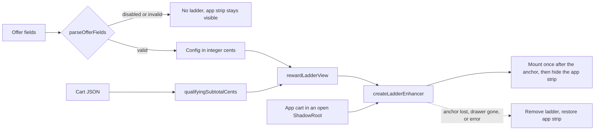

# Reward ladder for an app-owned cart

**Interactive route:** `/reward-ladder-demo` on a deployed version of this Next.js portfolio.

This demonstration shows how to add a tiered reward progress component to a cart that a third-party app owns and renders inside an **open Shadow DOM**. The shop, products, prices, offer values, and the "app" are all fictional. It is **independently developed example code**, not the source of any client theme, app configuration, or promotion.

**Related:** the [plan](REWARD_LADDER_PLAN.md) (`/reward-ladder-plan`) shows how this was planned before it was built, and the [design mockup](REWARD_LADDER_MOCKUP.md) (`/reward-ladder-mockup`) lets you step through the design states, using the same fictional offer.

## What the page lets you do

- Edit the **offer fields** (thresholds, labels, terms, on/off) and watch the ladder follow without any code change.
- Change the basket, add a cart discount, or add a gift card line, and see how the **qualifying subtotal basis** changes the outcome.
- Jump the subtotal to **one cent either side of each threshold** to see exact qualification.
- **Break the app** on purpose: re-render its drawer, change its markup, close it, or blank an offer field.

## Architecture



## Design rules

| Rule | Where it lives |
| --- | --- |
| Offer data is configuration, never logic | `parseOfferFields` in `lib/reward-ladder.mjs` |
| **Fail closed on data:** a disabled, blank, or malformed offer renders nothing, with no fallback amounts or names | `parseOfferFields` |
| **Fail open on structure:** the app's own strip is hidden only after the ladder is in place, and restored whenever the ladder is removed | `createLadderEnhancer` in `lib/reward-ladder-mount.mjs` |
| Qualification uses exact thresholds in integer cents | `rewardLadderView` (built on example 48's `rewardState`) |
| The bar is drawn in equal segments and never touches an unreached marker | `ladderFillPercent` |
| Copy inserts configured labels verbatim, so a label that already says "Free" is never doubled | `rewardLadderView` |
| The subtotal basis is one function, so it can be matched to the rule that actually grants rewards | `qualifyingSubtotalCents` |
| Re-renders, repeated reconciles, and stray duplicates converge on exactly one ladder | `createLadderEnhancer` |
| Offer labels are inserted with `textContent`, so markup in a label stays inert | `renderLadder` |

## Files

| File | Purpose |
| --- | --- |
| `lib/reward-ladder.mjs` (+ `.d.mts`) | Pure engine: parsing, subtotal basis, progress, copy |
| `lib/reward-ladder-mount.mjs` (+ `.d.mts`) | DOM enhancer: discovery, idempotent mount, observer, teardown |
| `lib/reward-ladder-demo-app.mjs` (+ `.d.mts`) | The fictional app cart used by the page and its tests |
| `app/reward-ladder-demo/page.tsx` | The interactive route |
| `tests/reward-ladder*.test.mjs` | 38 unit and integration tests |

## Run locally

```sh
npm install
npm test
npm run dev
```

Visit `http://localhost:3000/reward-ladder-demo`.

## Validation

- `tests/reward-ladder.test.mjs` (17 tests) covers parsing and every fail-closed case, one-cent boundaries at each threshold, verbatim copy, interpolation, and the subtotal basis with discounts and gift cards.
- `tests/reward-ladder-mount.test.mjs` (14 tests) runs the enhancer against a real open ShadowRoot in jsdom: idempotent mounting, five consecutive app re-renders, a stray duplicate, anchor loss, a missing drawer, an invalid offer, a thrown error, hostile label text, and a check that the observer settles instead of looping.
- `tests/reward-ladder-demo-app.test.mjs` (7 tests) drives the page's own simulated app against the enhancer.
- The enhancer tests were also checked by deliberately breaking the enhancer (no observer, no restore on teardown, no duplicate cleanup) and confirming the right tests fail.
- GitHub Actions also runs the publication safety scan, TypeScript, and the production build.

jsdom is not a browser. The interactive route has not been verified in every real browser, so check it on a deployed preview rather than assuming it works.

## Production boundaries

- This is a front-end illustration. It does not grant, apply, or fulfil any reward. Granting rewards belongs to server-side or checkout-side logic, and the displayed qualification must be verified against whatever rule actually grants them.
- Open Shadow DOM access is something the app can change. Where an app offers a supported extension surface, use that instead.
- Production use also needs accessibility testing with real assistive technology, mobile and desktop QA, and an observer scoped to the cart host rather than the whole document.
- No real products, prices, thresholds, selectors, credentials, customer data, or business rules are present.
