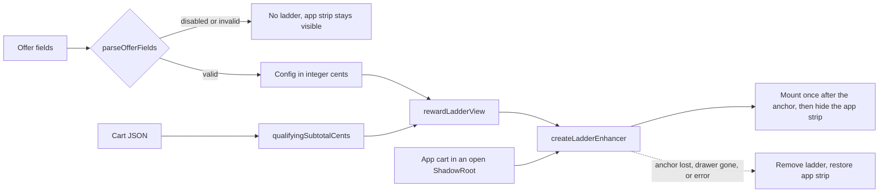

# Reward ladder for an app-owned cart

**Interactive route:** `/reward-ladder-demo` on a deployed version of this Next.js portfolio.

This demonstration shows how to add a tiered reward progress component to a cart that a third-party app owns and renders inside an **open Shadow DOM**. The shop, products, prices, offer values, and the "app" are all fictional. It is **independently developed example code**, not the source of any client theme, app configuration, or promotion.

**Related:** the [plan](REWARD_LADDER_PLAN.md) (`/reward-ladder-plan`) shows how this was planned before it was built, and the [design mockup](REWARD_LADDER_MOCKUP.md) (`/reward-ladder-mockup`) lets you step through the design states, using the same fictional offer.

## What the page lets you do

- Edit the **offer fields** (thresholds, labels, terms, on/off) and watch the ladder follow without any code change.
- Change the basket, add a cart discount, or add a gift card line, and see how the **qualifying subtotal basis** changes the outcome.
- Jump the subtotal to **one cent either side of each threshold** to see exact qualification.
- **Break the app** on purpose: re-render its drawer, change its markup, close it, or blank an offer field.

## Architecture



## Design rules

| Rule | Where it lives |
| --- | --- |
| Offer data is configuration, never logic | `parseOfferFields` in `lib/reward-ladder.mjs` |
| **Fail closed on data:** a disabled, blank, or malformed offer renders nothing, with no fallback amounts or names | `parseOfferFields` |
| **Fail open on structure:** the app's own strip is hidden only after the ladder is in place, and restored whenever the ladder is removed | `createLadderEnhancer` in `lib/reward-ladder-mount.mjs` |
| Qualification uses exact thresholds in integer cents | `rewardLadderView` (built on example 48's `rewardState`) |
| The bar is drawn in equal segments and never touches an unreached marker | `ladderFillPercent` |
| Copy inserts configured labels verbatim, so a label that already says "Free" is never doubled | `rewardLadderView` |
| The subtotal basis is one function, so it can be matched to the rule that actually grants rewards | `qualifyingSubtotalCents` |
| Re-renders, repeated reconciles, and stray duplicates converge on exactly one ladder | `createLadderEnhancer` |
| Offer labels are inserted with `textContent`, so markup in a label stays inert | `renderLadder` |

## Files

| File | Purpose |
| --- | --- |
| `lib/reward-ladder.mjs` (+ `.d.mts`) | Pure engine: parsing, subtotal basis, progress, copy |
| `lib/reward-ladder-mount.mjs` (+ `.d.mts`) | DOM enhancer: discovery, idempotent mount, observer, teardown |
| `lib/reward-ladder-demo-app.mjs` (+ `.d.mts`) | The fictional app cart used by the page and its tests |
| `app/reward-ladder-demo/page.tsx` | The interactive route |
| `tests/reward-ladder*.test.mjs` | 48 tests: 38 engine/enhancer/app tests, four documentation tests, and six mockup tests |

## Run locally

```sh
npm install
npm test
npm run dev
```

Visit `http://localhost:3000/reward-ladder-demo`.

## Validation

- `tests/reward-ladder.test.mjs` (17 tests) covers parsing and every fail-closed case, one-cent boundaries at each threshold, verbatim copy, interpolation, and the subtotal basis with discounts and gift cards.
- `tests/reward-ladder-mount.test.mjs` (14 tests) runs the enhancer against a real open ShadowRoot in jsdom: idempotent mounting, five consecutive app re-renders, a stray duplicate, anchor loss, a missing drawer, an invalid offer, a thrown error, hostile label text, and a check that the observer settles instead of looping.
- `tests/reward-ladder-demo-app.test.mjs` (7 tests) drives the page's own simulated app against the enhancer.
- The enhancer tests were also checked by deliberately breaking the enhancer (no observer, no restore on teardown, no duplicate cleanup) and confirming the right tests fail.
- GitHub Actions also runs the publication safety scan, TypeScript, and the production build.

jsdom checks are supplemented by the desktop Chrome preview checks recorded below. Actual mobile viewports, physical devices, other browsers, and assistive technology remain outside that verification.

### 18 November 2026: publication review

- **Target:** `bonvallite/developer-portfolio`, branch `feature/reward-ladder-demo`, based on main commit `9e9c0900889a51ad24700ace14371f6ab336b845`; Vercel project `developer-portfolio` in `my-dojo`.
- **Scope:** The six sanitised patches and their 26 changed paths. The private pack, patch inbox, and `package-lock.json` are excluded. The homepage outside the Reward Ladder block is unchanged. `package.json` adds only the `jsdom` development dependency; the CI file changes only a test-step label.
- **Release corrections:** `app/reward-ladder-demo/page.tsx` and `app/reward-ladder-mockup/page.tsx` now cap grid minimum widths at the available space, avoiding fixed tracks wider than narrow phone viewports. The demo's source link follows the published feature branch while the pull request remains unmerged. Adjacent JSX comments explain both dependencies. This document corrects the total Reward Ladder test count to 48.
- **Validation before those corrections:** All six patches applied cleanly. All 155 JavaScript tests and 16 Python tests passed; the publication scan passed for 163 tracked files; TypeScript, the Next.js production build, and Git whitespace checks passed. Review of all six commits found no newly introduced client source, private identifiers, credentials, or live offer data.
- **Validation after those corrections:** The 48 Reward Ladder tests, TypeScript check, and production build passed again. Real cloud Chrome checks used Vercel preview commit `9c6a380e7f3e74cf4f60afe4ffa55ff8912ba6f9`, with code tree `c7cb207b14832d8eac897d4fddc6313079c3c34a`.
- **Demo browser QA:** All six one-cent/exact-threshold controls produced the expected stages. Repeated app re-renders retained exactly one ladder. Changed app markup, a blank gift label, and a disabled offer restored the native strip; restoring markup or reopening the drawer remounted the ladder, and closing the drawer removed it. Changing and resetting the offer updated the expected values. Gift cards remained excluded, while cart-level discounts under `after_all_discounts` and quantity changes produced the expected qualifying subtotal.
- **Mockup browser QA:** States A to E, the $99/$100/$149/$150 slider boundaries, Today/Proposed switching, changed and disabled offers, all six design-note toggles, and quantity updates behaved as expected. The 360/390/480 px drawer-width controls worked, with no horizontal overflow inside the mockup cart. No application console errors were observed in the verified demo and mockup flows; browser-extension logs were excluded.
- **Navigation browser QA:** The plan rendered all nine content sections and five tables, with working navigation back to the portfolio. The homepage exposed the three expected links to the demo, plan, and mockup.
- **Open checks:** This browser evidence covers desktop Chrome and the mockup's drawer-width controls. It does not verify an actual mobile browser viewport, physical mobile devices, other browsers, screen-reader announcements, or a real store/checkout integration. Those checks remain pending. The local browser could not start because its runtime forbids a required socket; the browser evidence above comes from the deployed preview.
- **Release and recovery:** The recorded browser QA is for the preview; production has not been deployed at the time of this entry. Publication is authorised and the pull request must remain unmerged. The production release receipt and current release status are maintained in [PR #35](https://github.com/bonvallite/developer-portfolio/pull/35). Production deployment is to use the reviewed branch commit without changing the project's production branch. The existing main deployment is the recovery reference. A later deployment of main can replace this direct branch release until the pull request is separately merged.

This entry stays in the approved project documentation because the release scope excludes changes to unrelated files.

## Production boundaries

- This is a front-end illustration. It does not grant, apply, or fulfil any reward. Granting rewards belongs to server-side or checkout-side logic, and the displayed qualification must be verified against whatever rule actually grants them.
- Open Shadow DOM access is something the app can change. Where an app offers a supported extension surface, use that instead.
- Production use also needs accessibility testing with real assistive technology, mobile and desktop QA, and an observer scoped to the cart host rather than the whole document.
- No real products, prices, thresholds, selectors, credentials, customer data, or business rules are present.
