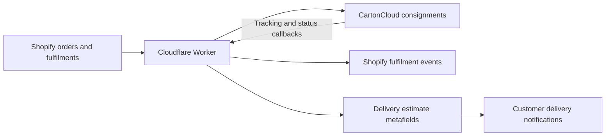
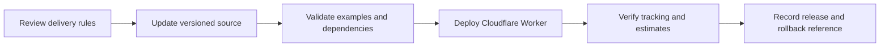

# GitHub Version Control & Cloudflare Workers Deployment

**Shopify + CartonCloud | Serverless integration case study | November 2026**

## Challenge
Delivery lead times vary with dispatch schedules, seasonal operating requirements and destination. Updating a single rule can affect multiple interconnected workflows, including fulfilment, delivery estimates and customer communications.

## System architecture

## What was implemented
- Centralised integration logic in the `shopify-cartoncloud-sync` Cloudflare Worker.
- Updated dispatch and estimated-delivery calculations for NSW and VIC, with QLD rules preserved.
- Maintained a versioned archive of the Worker source, rule changes and validation notes.
- Created the `Cloudflare_Serverless_App` GitHub repository to establish a source-controlled maintenance workflow.
- Deployed an updated production Worker version and recorded its release identity.

## Controlled release model

**Important distinction:** GitHub-driven automatic CI/CD deployment is a proposed improvement, not a verified feature of the current implementation. This case study describes version control and controlled deployment, not an automated release pipeline.

## Why it matters
A lead-time adjustment is a business-rule change with downstream technical consequences. Traceable code versions, deployment records and validation reduce ambiguity when shipping policies change.

## Public-sharing boundaries
Architecture is simplified. No production credentials, private endpoints, customer records or confidential payloads are included.

## LinkedIn document
**Title:** GitHub Version Control & Cloudflare Workers Deployment

The companion four-page visual PDF is intended to be stored as `public/case-studies/cloudflare-controlled-deployments.pdf` and linked from the portfolio project page. **PDF publication remains pending until the binary asset is committed and its served URL is verified.**
