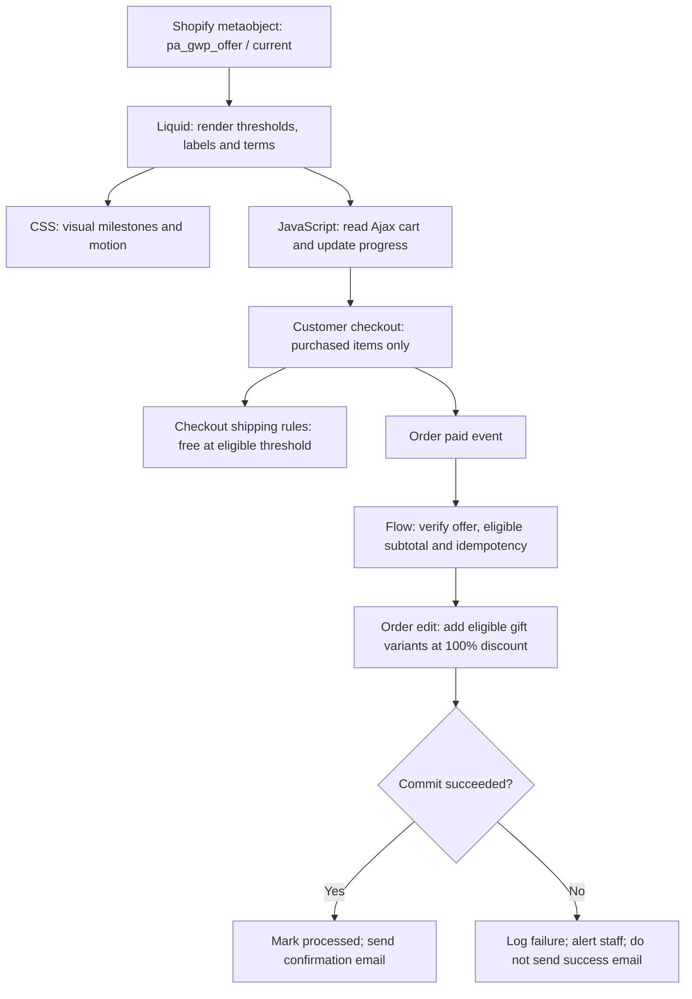

# Spend & Save: architecture, code and production safeguards

> **Portfolio reference only.** This is a sanitised, educational reconstruction based on the documented Peter Augustus promotion. It is not an export of the live theme or the verified Shopify Flow. The accompanying visual mock-up is conceptual; any uplift percentages shown in concept artwork are **not actual performance results**.

## Business rules

- A$150: 2 complimentary Wagyu Burger Patties (175 g), added to the **order after checkout**.
- A$200: free shipping, configured **at checkout**, not by post-checkout Flow.
- A$300: complimentary Angus Rib Fillet SB 3 (300 g), added to the **order after checkout** in addition to the patties.
- Progress bar and animations are **informational only**. Never add gifts to the cart from storefront JavaScript.

## Architecture



## Liquid example (theme snippet, illustrative)

```liquid

  Spend & Save presentation only.
  Reads the active offer. Does not mutate cart or orders.
  Thresholds in dollars are converted to cents for Shopify money filters.



  
  
  
  <section class="pa-rewards"
    data-pa-spend-save
    data-tier-one="{{ tier_one }}"
    data-shipping="{{ shipping }}"
    data-tier-two="{{ tier_two }}">
    <p data-reward-message aria-live="polite">Discover your next reward.</p>
    <div class="pa-rewards__track" role="progressbar"
      aria-label="Reward progress" aria-valuemin="0"
      aria-valuenow="0" aria-valuemax="{{ tier_two }}"
      data-reward-track>
      <span class="pa-rewards__fill" data-reward-fill></span>
    </div>
    <ul>
      <li data-reward-tier="{{ tier_one }}">{{ tier_one | times: 100 | money }}: {{ offer.tier1_gift.value | escape }}</li>
      <li data-reward-tier="{{ shipping }}">{{ shipping | times: 100 | money }}: Free shipping</li>
      <li data-reward-tier="{{ tier_two }}">{{ tier_two | times: 100 | money }}: {{ offer.tier2_gift.value | escape }}</li>
    </ul>
    <small>Eligible gifts are added to your order after checkout.</small>
  </section>

```

## JavaScript example (storefront only)

```javascript
/**
 * Display-only rewards. Never adds gifts or edits checkout.
 * Refresh after a successful cart mutation using the theme's verified cart event.
 */
async function refreshSpendSave() {
  const rootPath = window.Shopify?.routes?.root || '/';
  const response = await fetch(rootPath + 'cart.js', { credentials: 'same-origin' });
  if (!response.ok) return;
  const cart = await response.json();
  const subtotal = cart.total_price / 100;
  document.querySelectorAll('[data-pa-spend-save]').forEach(root => {
    const thresholds = [
      Number(root.dataset.tierOne),
      Number(root.dataset.shipping),
      Number(root.dataset.tierTwo)
    ];
    if (thresholds.some(t => !Number.isFinite(t) || t <= 0)) return;
    const highest = Math.max(...thresholds);
    const next = thresholds.slice().sort((a,b) => a-b).find(t => subtotal < t);
    const message = root.querySelector('[data-reward-message]');
    if (message) message.textContent = next
      ? 'You are ' + new Intl.NumberFormat('en-AU', {style:'currency',currency:'AUD'}).format(next-subtotal) + ' away from your next reward.'
      : 'All rewards unlocked. Eligible gifts are added after checkout.';
    const fill = root.querySelector('[data-reward-fill]');
    if (fill) fill.style.width = Math.min(100, subtotal/highest*100) + '%';
    const track = root.querySelector('[data-reward-track]');
    if (track) track.setAttribute('aria-valuenow', String(Math.min(subtotal,highest)));
    root.querySelectorAll('[data-reward-tier]').forEach(tier => {
      tier.classList.toggle('is-unlocked', subtotal >= Number(tier.dataset.rewardTier));
    });
  });
}
document.addEventListener('DOMContentLoaded', refreshSpendSave, {once:true});
// Connect to the *actual* Willow theme cart lifecycle after inspection.
document.addEventListener('pa:cart:updated', refreshSpendSave);
```

## CSS example (accessible animation)

```css
.pa-rewards__track { height: 8px; border-radius: 999px; overflow: hidden; background: #e9e0ce; }
.pa-rewards__fill { display: block; width: 0; height: 100%; background: #947a41; transition: width 350ms ease; }
.pa-rewards [data-reward-tier] { color: #6c6b65; }
.pa-rewards [data-reward-tier].is-unlocked { color: #947a41; font-weight: 700; }
@media (prefers-reduced-motion: reduce) {
  .pa-rewards__fill { transition: none; }
}
```

## Shopify Flow / order-edit pseudocode

```text
TRIGGER: Order paid
1. Read offer config from an authorised server-side source.
2. Confirm offer enabled, paid order, qualifying lines, currency and subtotal rules.
3. Reject gift-only totals, cancellations, excluded orders and already processed orders.
4. Resolve actual gift variant IDs from approved configuration (text labels alone are insufficient).
5. Determine eligible quantities: tier 1 => 2 patties; tier 2 => 1 rib fillet as well.
6. Validate inventory and fulfilment compatibility.
7. Start Shopify order edit using supported Admin GraphQL operations.
8. Add eligible variant quantities and apply a full discount to gift lines.
9. Commit the order edit; verify success and resulting order lines.
10. Persist idempotency marker / processing result.
11. Only on verified success, send customer email listing the actual gifts added.
12. On failure, alert staff; do not claim gifts were added.
```

**Implementation note:** Exact Admin API mutation arguments, permissions, Flow actions and customer notification mechanism depend on the installed app, API version, and merchant configuration. Do not paste pseudocode into production Flow. An order edit may affect taxes, shipping, inventory and fulfilment. The current metaobject gift fields are text descriptions, not verified variant references.

## Real-store best practices to verify

1. Read the live theme's `pa-theme-changelog`, cart source and inline comments before any theme edit.
2. Confirm the cart's actual Ajax lifecycle and rerender hooks; avoid duplicate listeners and expensive polling.
3. Use one metaobject as the merchandising source of truth; validate thresholds and offer status.
4. Maintain the exact separation between promotional display, checkout shipping logic and order automation.
5. Make Flow idempotent; protect against duplicate webhooks, reruns and concurrent order edits.
6. Confirm variants, inventory, eligibility and order edit support; fail safely and alert staff.
7. Send the customer email **only after** successful order edit; avoid duplicate notifications.
8. Validate accessibility, keyboard focus, reduced motion, mobile mini-cart behaviour and AUD formatting.
9. Measure reward visibility, cart progression, AOV, conversion, gift cost, shipping subsidy and contribution margin.
10. Never publish live customer information, credentials, private workflow exports or unsupported revenue uplift claims.

## Validation and status

- Portfolio demo: standalone React simulation at `/projects/spend-and-save` on a feature branch.
- Shopify theme: **not edited**.
- Live Shopify Flow: **not inspected or changed**.
- Automated tests, production integration and email delivery: **not verified**.

## Portfolio Stage 4 enhancement, 20 November 2026

Updated `app/projects/spend-and-save/page.tsx` on `feature/ember-teal-interactive-portfolio`: the six-stage fictional post-checkout Flow now has a live explanatory panel driven by the existing stage state. The simulation continues to reveal gift order lines only after the commit stage and the email preview only at the notification stage. The demonstration checkout respects `prefers-reduced-motion` for scrolling. Added scoped Ember & Teal styling and focus-visible treatment. No Shopify theme, Shopify Flow, live order, or email was changed.

**Verification:** GitHub source commit confirmed. Automated tests, TypeScript checks, visual QA and Vercel preview have not yet been run or verified; no production release.
