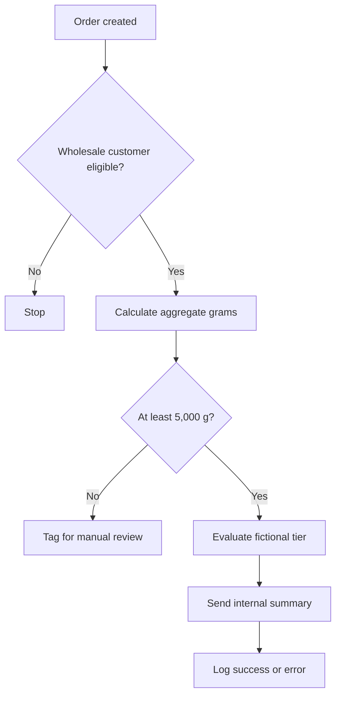

# Shopify Flow and Liquid email examples

These are **independently authored portfolio illustrations**, not exported Shopify Flow workflows or original company notification templates. The thresholds, labels, products, and recipients are fictional.

## Example workflow

The example `run-code.js` is an illustrative Shopify Flow **Run code action** function. It expects mapped order fields from a preceding action and returns a structured tier result. Map its input fields in the Flow editor and validate the actual Flow Run code schema before deployment. This is **not** a directly importable workflow.

`internal-order-email.liquid` shows a mock Shopify Flow **Send internal email** body that refers to prior step output via an example variable. In a real Flow, replace this variable with the exact output path exposed by your Flow steps. The input and output variable names used here are placeholders, not verified Shopify Flow bindings.

`order-notification-email.liquid` shows an independently written customer-facing Shopify notification template using common Liquid objects. It is not for production use without reviewing the notification context, previewing data and testing in the target store.

No live Shopify store ID, email address, customer, discount tier, workflow export, or company-specific configuration is included.

## Security and validation
- Apply customer eligibility and discounts **server-side** using authorised Shopify capabilities. A Flow email is not pricing enforcement.
- Do not include payment information, customer addresses, access tokens, raw request bodies, or proprietary business rules in internal notifications.
- Confirm that the Flow trigger exposes the fields referenced by the Run code mapping and the Send internal email action.
- Test empty line items, missing weights, deleted products, unexpected units, retries, duplicate triggers, and notification destinations in a sandbox store.
- Email templates must be previewed in the real Shopify editor before use.
