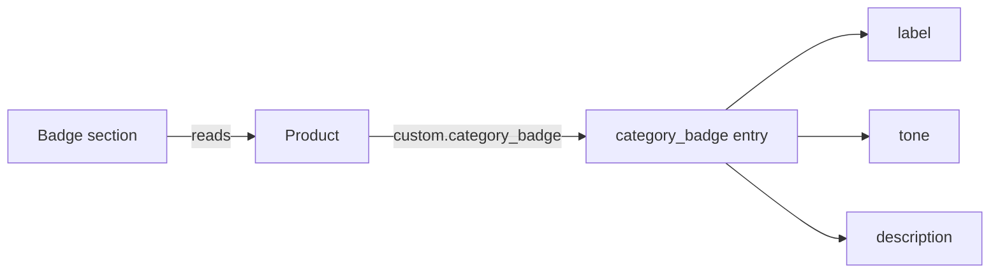

# Theme sections

Two independently written Shopify Online Store 2.0 sections. They are **illustrative**: written for this portfolio with fictional content, not taken from any store's theme, and not tested in a live store. Copy them into a development theme and preview them before you use them anywhere real.

| File | What it shows |
|---|---|
| [sections/product-category-badge.liquid](sections/product-category-badge.liquid) | A product badge read from a metaobject reference, with one source of truth |
| [sections/campaign-phases.liquid](sections/campaign-phases.liquid) | A landing section whose headline and offer change by date, scheduled entirely in the theme editor |

Neither section needs configuration, environment variables, or credentials, so there is no `.env.example` for them.

## Category badge: data model

The badge lives in a metaobject so that merchandisers manage the wording and colour once, and every product that references it updates together.

**Metaobject definition** `category_badge` (create it in *Settings → Custom data → Metaobjects*):

| Field key | Type | Purpose |
|---|---|---|
| `label` | Single line text | Text shown on the badge, for example "Small batch" |
| `tone` | Single line text, limited to a list of choices: `neutral`, `positive`, `attention` | Picks a colour style |
| `description` | Multi-line text (optional) | Short explanation, shown only if the section setting allows it |

**Product metafield** `custom.category_badge`, of type *Metaobject reference* to `category_badge`.



Design choices:
- **One source of truth.** The section reads only the metafield. It does not fall back to product tags, because two sources drift apart (see [case study 10](../CASE_STUDIES.md#10-diagnosing-a-badge-that-came-from-stale-tags)).
- **Safe output.** Text fields are escaped, and `tone` must match an allowed value before it becomes part of a class name. Anything else renders as `neutral`.
- **Accessible.** The meaning is in the label text, not the colour, and every text and background pair has a contrast ratio of at least 7:1 (WCAG AAA).
- **Editor feedback.** In the theme editor, a product without a badge shows a short note instead of an unexplained gap. Shoppers see nothing.
- **Reusable.** On a product template the section uses the current product. Elsewhere, an editor picks a product in the section settings.

## Campaign phases: how editors use it

1. Add the **Campaign phases** section to a page or landing template.
2. Add one **Phase** block per stage of the campaign, for example early access, the main event, and a last chance.
3. Give each block a start and end date in `YYYY-MM-DD` format. Both dates are inclusive, and an empty date means "no limit".
4. Add a final block with **no dates** as the evergreen fallback for when the campaign is over.
5. Use **Preview date** in the section settings to check a future phase in the theme editor. Shoppers never see the preview.

If two phases overlap, the block higher in the list wins, so editors control priority by dragging blocks.

Limitations, stated plainly:
- "Today" is the shop's local date at render time. Shopify caches storefront pages, so a phase may switch a little after midnight rather than exactly at midnight. For anything that must change on the minute, such as a price, use the discount's own scheduling.
- This section changes the message only. Offers and prices must be configured separately, as real Shopify discounts.
- Theme settings have no date picker, so dates are typed as text. A badly formatted date makes that phase never match, and the theme editor note shows which phase is active so editors can spot this.

## Validation

```sh
npm test
```

- `tests/theme-sections.test.mjs` renders both sections with [liquidjs](https://liquidjs.com/) and fictional data. It checks phase selection at each boundary, overlap priority, preview-date isolation, escaping, the tone allow-list, product override, and that every setting the template reads is declared in its schema.
- `tests/liquid-structure.test.mjs` checks that block tags are balanced.

liquidjs is not Shopify's renderer. Shopify-only tags such as `` are stubbed in the tests, so passing tests show the section logic is right, not that the section has been verified on Shopify.
