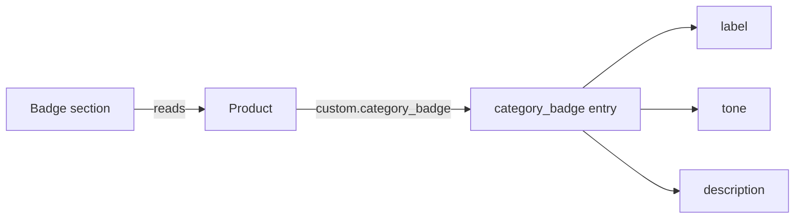

# Theme sections, snippet, and templates

Independently written Shopify Online Store 2.0 theme files. They are **illustrative**: written for this portfolio with fictional content, not taken from any store's theme, and not tested in a live store. Copy them into a development theme and preview them before you use them anywhere real.

| File | What it shows |
|---|---|
| [sections/product-category-badge.liquid](sections/product-category-badge.liquid) | A product badge read from a metaobject reference, with one source of truth |
| [sections/campaign-phases.liquid](sections/campaign-phases.liquid) | A landing section whose headline and offer change by date, scheduled entirely in the theme editor |
| [sections/hero-slideshow.liquid](sections/hero-slideshow.liquid) | A homepage hero with swipeable slides, no autoplay, and a fast first image |
| [sections/featured-collection.liquid](sections/featured-collection.liquid) | A product grid for a chosen collection, with lazy-loaded images |
| [snippets/hero-image.liquid](snippets/hero-image.liquid) | A slideshow image that loads the first slide fast for LCP and keeps the rest lazy |
| [templates/page.campaign-landing.json](templates/page.campaign-landing.json) | A landing page template built from the campaign section |
| [templates/index.json](templates/index.json) | A homepage: hero slideshow, seasonal banner, and featured collection |
| [templates/page.seasonal-landing.json](templates/page.seasonal-landing.json) | A seasonal landing page that switches between Christmas, Boxing Day, and EOFY every year |

None of these files needs configuration, environment variables, or credentials, so there is no `.env.example` for them.

## Category badge: data model

The badge lives in a metaobject so that merchandisers manage the wording and colour once, and every product that references it updates together.

**Metaobject definition** `category_badge` (create it in *Settings → Custom data → Metaobjects*):

| Field key | Type | Purpose |
|---|---|---|
| `label` | Single line text | Text shown on the badge, for example "Small batch" |
| `tone` | Single line text, limited to a list of choices: `neutral`, `positive`, `attention` | Picks a colour style |
| `description` | Multi-line text (optional) | Short explanation, shown only if the section setting allows it |

**Product metafield** `custom.category_badge`, of type *Metaobject reference* to `category_badge`.



Design choices:
- **One source of truth.** The section reads only the metafield. It does not fall back to product tags, because two sources drift apart (see [case study 10](../CASE_STUDIES.md#10-diagnosing-a-badge-that-came-from-stale-tags)).
- **Safe output.** Text fields are escaped, and `tone` must match an allowed value before it becomes part of a class name. Anything else renders as `neutral`.
- **Accessible.** The meaning is in the label text, not the colour, and every text and background pair has a contrast ratio of at least 7:1 (WCAG AAA).
- **Editor feedback.** In the theme editor, a product without a badge shows a short note instead of an unexplained gap. Shoppers see nothing.
- **Reusable.** On a product template the section uses the current product. Elsewhere, an editor picks a product in the section settings.

## Campaign phases: how editors use it

1. Add the **Campaign phases** section to a page or landing template.
2. Add one **Phase** block per stage of the campaign, for example early access, the main event, and a last chance.
3. Give each block a start and end date. Use `YYYY-MM-DD` for a one-off campaign, or `MM-DD` for a season that repeats every year, and use the same format for both dates in a block. Both dates are inclusive, and an empty date means "no limit". An `MM-DD` range whose end is earlier than its start wraps over New Year, so `12-26` to `01-02` covers Boxing Day to 2 January.
4. Add a final block with **no dates** as the evergreen fallback for when the campaign is over.
5. Use **Preview date** in the section settings to check a future phase in the theme editor. Shoppers never see the preview.

If two phases overlap, the block higher in the list wins, so editors control priority by dragging blocks.

Limitations, stated plainly:
- "Today" is the shop's local date at render time. Shopify caches storefront pages, so a phase may switch a little after midnight rather than exactly at midnight. For anything that must change on the minute, such as a price, use the discount's own scheduling.
- This section changes the message only. Offers and prices must be configured separately, as real Shopify discounts.
- Theme settings have no date picker, so dates are typed as text. A badly formatted date makes that phase never match, and the theme editor note shows which phase is active so editors can spot this.

## Hero image snippet

[snippets/hero-image.liquid](snippets/hero-image.liquid) renders slideshow images so that the first slide, which is usually the Largest Contentful Paint element, starts downloading at once: a real `src` instead of `data-src`, `loading="eager"`, `fetchpriority="high"`, and explicit dimensions. Later slides stay lazy. The `srcset` stops at the uploaded width, so the CDN is never asked to upscale. It comes from the audit in [case study 12](../CASE_STUDIES.md#12-performance-baseline-audit-for-a-shopify-storefront).

```liquid

  

```

## Homepage template

[templates/index.json](templates/index.json) builds a homepage from three sections:

1. **Hero slideshow.** Up to five slides. The first slide's image loads first and fastest, and the first heading is the page's `h1`. Slides don't autoplay: visitors swipe or scroll, which is easier to read, works without JavaScript, and doesn't download every slide's image straight away.
2. **Seasonal banner.** The campaign section with yearly `MM-DD` phases for Christmas and the end of the financial year. It has no evergreen phase on purpose, so outside those seasons the banner simply doesn't appear on the storefront.
3. **Featured collection.** Pick a collection in the theme editor. Product images are lazy-loaded with fixed dimensions, so the grid never competes with the hero.

Images and the collection are chosen in the theme editor, because a template can't contain a store's real files.

## Seasonal landing page

[templates/page.seasonal-landing.json](templates/page.seasonal-landing.json) is a page that changes with the season, every year, without anyone editing dates: Christmas (1 to 24 December), Boxing Day to New Year (26 December to 2 January), the end of the financial year (June), and an evergreen fallback for the rest of the year. Assign it to a page such as `/pages/seasonal` and link to it from the homepage banner.

## Landing page template

[templates/page.campaign-landing.json](templates/page.campaign-landing.json) is an alternate page template built from the campaign section, with three example phases. Assign it to a page in *Online Store > Pages*, then change the content in the theme editor. To compare two versions of a landing page, duplicate the template under a new name (for example `page.campaign-landing-b`), change one thing, and point each campaign link, or a split-testing app, at a different page. Add your theme's own header-dependent or product sections alongside it as needed.

## Validation

```sh
npm test
```

- `tests/theme-sections.test.mjs` renders both sections with [liquidjs](https://liquidjs.com/) and fictional data. It checks phase selection at each boundary, overlap priority, preview-date isolation, escaping, the tone allow-list, product override, and that every setting the template reads is declared in its schema.
- The same file renders the hero snippet, slideshow, and featured collection, checks yearly seasonal dates including the New Year wrap, and checks that every template only uses sections, blocks, and settings that exist.
- `tests/liquid-structure.test.mjs` checks that block tags are balanced.

liquidjs is not Shopify's renderer. Shopify-only tags such as `` are stubbed in the tests, so passing tests show the section logic is right, not that the section has been verified on Shopify.
